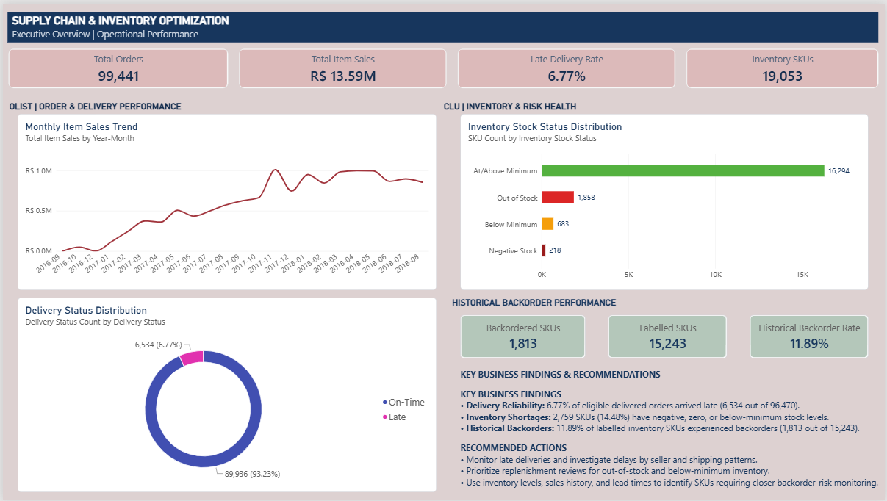
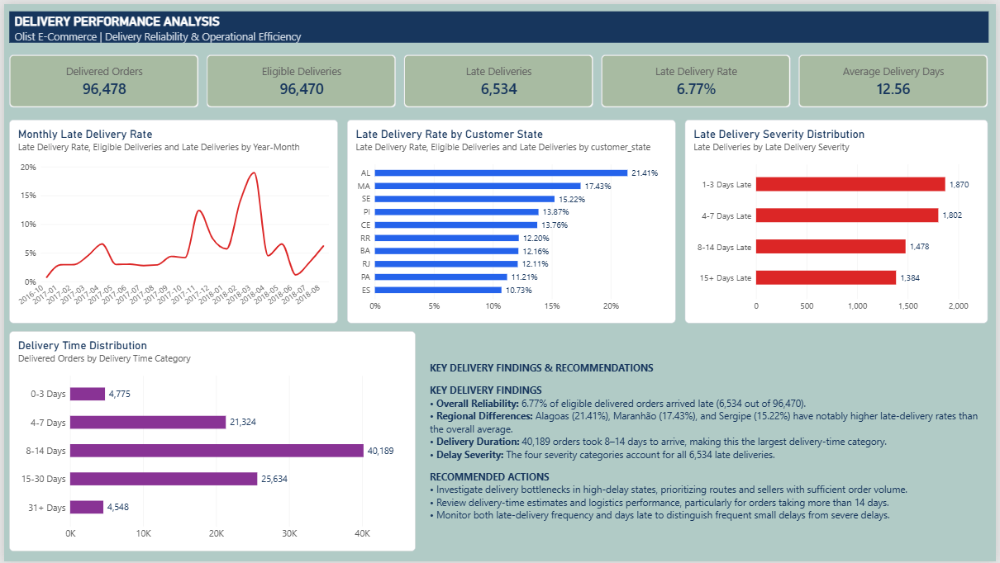
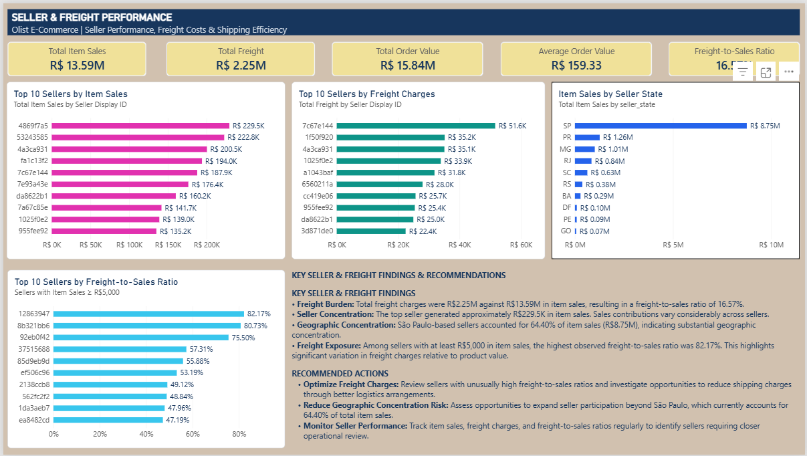
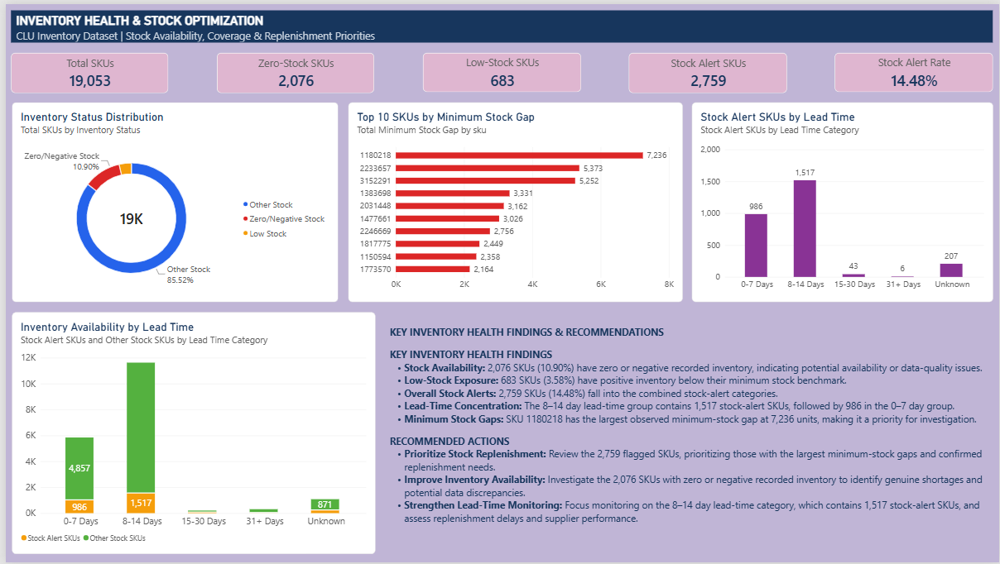
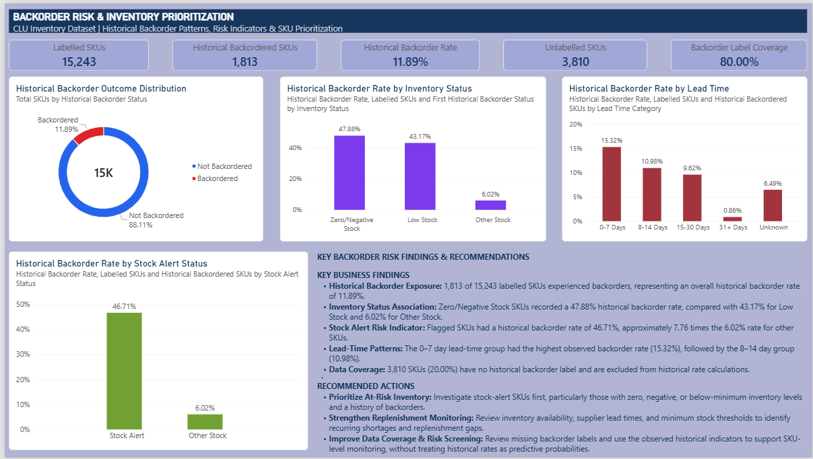
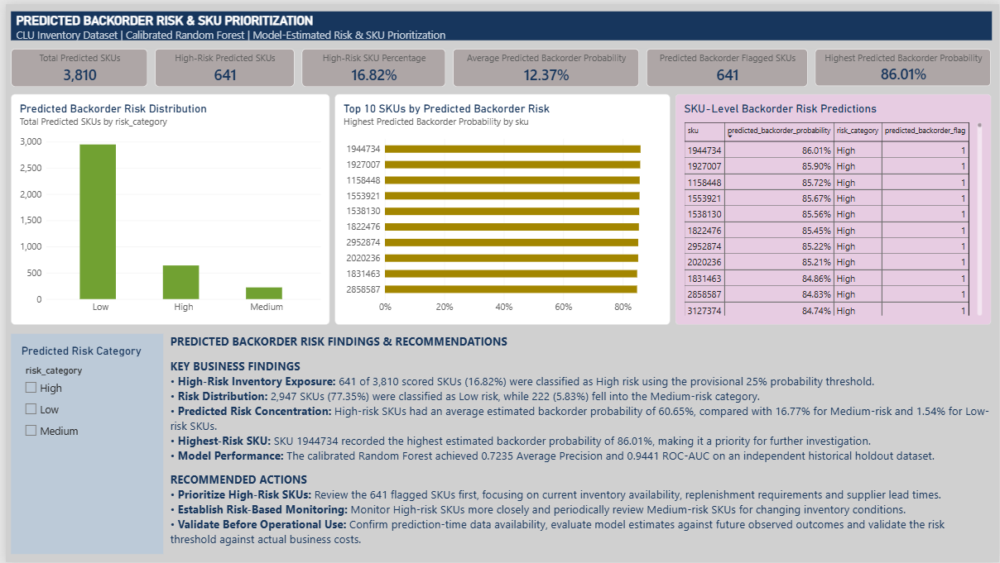
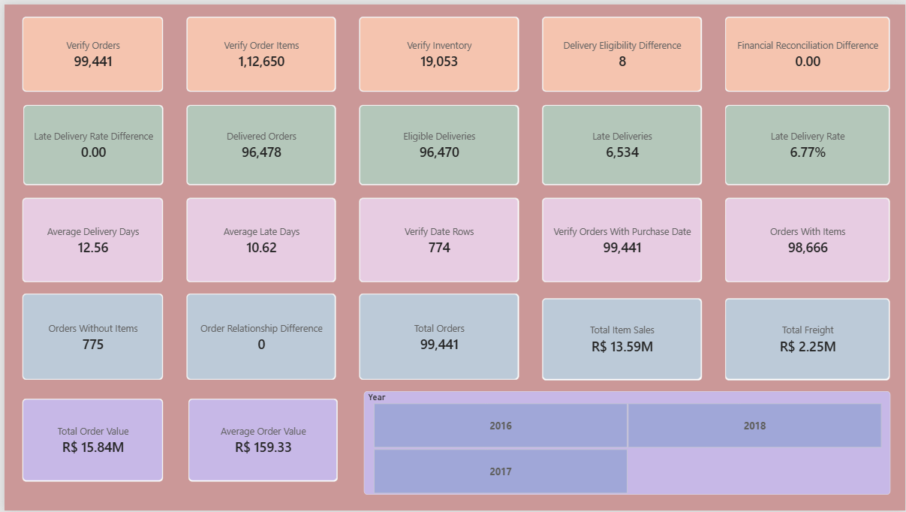
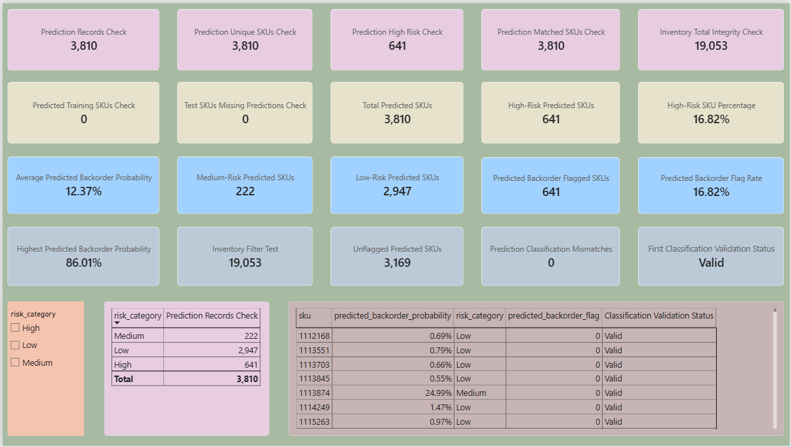

# Supply Chain & Inventory Optimization
### End-to-End SQL, Power BI & Python Machine Learning Project

## 1. Project Overview

This project presents an end-to-end approach to supply chain analytics, combining PostgreSQL, Power BI, and Python to analyze operational performance, identify inventory risks, and support data-driven business decisions.

The analysis covers e-commerce order performance, delivery reliability, seller and freight efficiency, inventory availability, historical backorder patterns, and machine-learning-based backorder risk estimation.

The project uses two independent datasets: the Olist Brazilian E-Commerce dataset for order and logistics analysis, and the CLU Inventory dataset for inventory health and backorder risk assessment.

The workflow includes data-quality auditing, SQL-based data preparation, analytical data modeling, interactive dashboard development, predictive modeling, and model validation.

### Project Highlights

- **99,441 e-commerce orders** and **112,650 order items** analyzed.
- **19,053 inventory SKUs** examined for stock availability and backorder-related indicators.
- **Six business-focused Power BI dashboards** developed, supported by two quality-assurance pages.
- **PostgreSQL** used for data cleaning, transformation, validation, and analytical table development.
- **Python and scikit-learn** used to develop a sigmoid-calibrated Random Forest classifier.
- **0.7235 Average Precision** and **0.9441 ROC-AUC** achieved on an untouched historical holdout dataset.
- **3,810 unlabelled inventory SKUs** scored using the trained model.
- **641 SKUs** classified as High risk using a provisional 25% probability threshold.

The final solution brings together business intelligence and machine learning, providing both historical operational insights and model-estimated inventory risk indicators.

---


## 2. Business Objectives

The primary objective is to transform raw supply chain and inventory data into meaningful insights that can support operational monitoring, performance evaluation, and inventory prioritization.

The project focuses on five major business objectives.

### 2.1 Order and Revenue Performance

Analyze e-commerce order activity and sales performance to understand:

- Overall order volume and item sales.
- Monthly sales trends and fluctuations.
- Operational performance across the available transaction history.

### 2.2 Delivery Reliability and Logistics Efficiency

Evaluate delivery performance to identify:

- The proportion of deliveries arriving after their estimated dates.
- Regional differences in late delivery rates.
- Delivery-time patterns and delay severity.
- Opportunities for investigating logistical inefficiencies.

### 2.3 Seller and Freight Performance

Examine seller-level commercial performance and shipping costs to:

- Identify leading sellers by item sales.
- Compare freight charges across sellers.
- Evaluate freight-to-sales ratios.
- Understand geographic concentration of seller activity.

### 2.4 Inventory Health and Historical Backorder Risk

Assess inventory availability and historical backorder patterns to:

- Identify SKUs with zero, negative, or below-minimum inventory.
- Examine minimum-stock gaps and replenishment indicators.
- Analyze inventory availability across lead-time categories.
- Compare historical backorder rates across inventory groups.
- Identify SKUs that warrant closer operational investigation.

### 2.5 Predictive Backorder Risk Assessment

Develop a machine-learning model to estimate SKU-level backorder risk and support analytical inventory prioritization.

Specific objectives include:

- Comparing classification models using cross-validation.
- Evaluating performance on an untouched labelled holdout dataset.
- Calibrating predicted probabilities.
- Classifying unlabelled SKUs into Low, Medium, and High risk categories.
- Integrating model outputs into PostgreSQL and Power BI.
- Presenting risk estimates through interactive visualizations.

**Important distinction:** Historical backorder outcomes and model-estimated risk scores are analyzed separately. The predictive results support prioritization but do not establish confirmed future backorders.

---


## 3. Tools & Technologies

This project combines database management, business intelligence, machine learning, and documentation tools to build an end-to-end analytical workflow.

### 3.1 Database Management & SQL

| Technology | Application |
|---|---|
| PostgreSQL | Raw data storage, cleaning, transformation, validation, and analytical data modeling |
| pgAdmin | Database management, SQL query execution, and data verification |
| SQL | Data quality checks, joins, transformations, aggregations, and reporting-ready analytical tables |

The PostgreSQL database was organized into separate schemas for raw data, cleaned data, intermediate analytical structures, and reporting tables.

### 3.2 Business Intelligence & Data Visualization

| Technology | Application |
|---|---|
| Microsoft Power BI | Interactive dashboards, business performance analysis, and predictive risk visualization |
| Power Query | PostgreSQL data import, data type validation, and query preparation |
| DAX | KPI calculations, historical backorder metrics, predictive measures, and quality-assurance checks |
| Power BI Data Modeling | Table relationships, filter propagation, and analytical reporting |

The Power BI report contains six business-focused dashboard pages and two supporting quality-assurance pages.

### 3.3 Python & Machine Learning

| Technology | Application |
|---|---|
| Python | Data preparation, predictive modeling, SKU risk scoring, and evaluation |
| pandas | Dataset manipulation, feature preparation, and prediction exports |
| NumPy | Numerical calculations and array operations |
| scikit-learn | Classification models, cross-validation, preprocessing, calibration, and model evaluation |
| Matplotlib | Model evaluation charts and visual analysis |
| Seaborn | Supporting statistical visualizations |
| Joblib | Saving and reloading the trained machine-learning pipeline |
| Jupyter Notebook | Interactive experimentation and documentation of the modeling workflow |

The final predictive model was a sigmoid-calibrated Random Forest classifier developed using 15 numerical predictors.

### 3.4 Development, Auditing & Documentation

| Technology | Application |
|---|---|
| Visual Studio Code | Python development, SQL scripts, project organization, and Markdown documentation |
| Microsoft Excel | Initial dataset auditing, quality checks, and supporting analytical documentation |
| Markdown | Technical documentation and GitHub README development |
| GitHub | Planned presentation of the completed project, source code, methodology, and results |

---


## 4. Data Sources

The project uses two independent datasets to analyze different aspects of supply chain and inventory performance.

The datasets are integrated into a common analytical reporting environment but are not treated as transactionally connected sources.

### 4.1 Olist Brazilian E-Commerce Dataset

**Dataset:** Brazilian E-Commerce Public Dataset by Olist

**Source:** Kaggle

**Dataset Link:** https://www.kaggle.com/datasets/olistbr/brazilian-ecommerce

The Olist dataset contains historical Brazilian e-commerce information covering orders, customers, sellers, products, payments, reviews, freight charges, and delivery performance.

#### Source Tables

The project uses the following Olist tables:

1. Orders
2. Order Items
3. Products
4. Sellers
5. Customers
6. Order Payments
7. Order Reviews
8. Geolocation
9. Product Category Translation

#### Dataset Scope

The final analytical tables contain:

| Metric | Value |
|---|---:|
| Total Orders | 99,441 |
| Total Order Items | 112,650 |
| Delivered Orders | 96,478 |
| Eligible Deliveries | 96,470 |
| Late Deliveries | 6,534 |
| Total Item Sales | Approximately R$13.59M |

#### Analytical Applications

The Olist dataset supports:

- Order volume and item sales analysis
- Monthly sales trends
- Delivery reliability and delay severity
- Regional delivery performance
- Seller sales concentration
- Freight costs and freight-to-sales ratios

The dataset is used primarily in the Executive Overview, Delivery Performance, and Seller & Freight dashboards.

### 4.2 CLU Inventory / Backorder Dataset

**Dataset:** High-dimensional inventory and backorder data used for SKU-level inventory analysis.

**Source:** Project inventory training and test files.

The CLU dataset contains numerical inventory indicators, historical sales information, lead times, supplier performance measures, stock thresholds, and backorder-related fields.

#### Dataset Scope

| Dataset Component | Records |
|---|---:|
| Labelled Training SKUs | 15,243 |
| Unlabelled Test SKUs | 3,810 |
| Total Inventory SKUs | 19,053 |
| Historically Backordered Training SKUs | 1,813 |
| Historically Non-Backordered Training SKUs | 13,430 |

The training dataset contains the historical binary target variable:

`went_on_backorder`

The unlabelled test dataset is used to generate model-estimated backorder risk scores.

#### Key Inventory Features

The dataset includes:

- National inventory quantities
- In-transit inventory
- Minimum-stock levels
- Historical sales across multiple periods
- Supplier lead times
- Supplier performance indicators
- Stock and operational constraint indicators
- Historical backorder outcomes for labelled records

#### Analytical Applications

The CLU inventory dataset supports:

- Inventory availability analysis
- Zero-stock and low-stock identification
- Minimum-stock gap assessment
- Stock-alert monitoring
- Lead-time analysis
- Historical backorder risk assessment
- Machine-learning-based SKU risk estimation

The dataset is used in the Inventory Health, Historical Backorder Risk, and Predicted Backorder Risk dashboards.

### 4.3 Important Dataset Distinction

Olist and CLU represent separate analytical datasets.

No verified shared transaction identifier or real-world SKU relationship exists between the two sources.

Therefore:

- Olist supports e-commerce, delivery, seller, and freight analysis.
- CLU supports inventory health and backorder risk analysis.
- CLU machine-learning predictions are not presented as forecasts of Olist product orders.
- Historical backorder outcomes are kept separate from predicted backorder probabilities.

This distinction is maintained throughout the SQL, Python, and Power BI workflows.

---


## 5. Project Architecture & Workflow

The project follows a structured, six-phase analytical workflow combining data auditing, SQL engineering, Power BI reporting, and Python machine learning.

The workflow was designed to separate raw data preparation, historical business intelligence, and model-estimated inventory risk while maintaining traceability between the source data and final analytical outputs.

### 5.1 Phase 1 — Business Understanding & Data Quality Audit

The project began by defining the business problems, analytical objectives, key performance indicators, and data-quality requirements.

Activities included:

- Defining business questions and analytical hypotheses.
- Establishing KPI definitions and calculation requirements.
- Reviewing the structure and relationships of the source datasets.
- Auditing missing values, duplicates, numerical anomalies, and timestamp inconsistencies.
- Evaluating dataset feasibility and identifying potential analytical limitations.
- Documenting audit findings and supporting validation evidence.

Microsoft Excel was used for the initial audit and documentation process.

### 5.2 Phase 2 — PostgreSQL Data Engineering

The Olist and CLU datasets were imported into PostgreSQL for structured data preparation and analytical modeling.

The database was organized into four schemas:

| Schema | Purpose |
|---|---|
| `raw` | Preserves the imported source datasets |
| `clean` | Stores validated and standardized records |
| `analytics` | Supports intermediate analytical transformations |
| `mart` | Contains reporting-ready tables and model outputs |

Data preparation included data-type standardization, integrity checks, cleaning, derived indicators, and the development of analytical tables.

### 5.3 Phase 3 — Power BI Data Modeling

Power BI Desktop was connected to the PostgreSQL database.

Activities included:

- Importing reporting-ready analytical tables.
- Validating field names and data types in Power Query.
- Configuring relationships between related tables.
- Creating a date dimension for order analysis.
- Developing DAX measures for operational KPIs.
- Verifying data consistency between PostgreSQL and Power BI.

The model preserves the distinction between Olist e-commerce records and CLU inventory records.

### 5.4 Phase 4 — Business Intelligence Dashboards

Interactive Power BI dashboards were developed to analyze:

1. Executive-level supply chain performance.
2. Delivery reliability and logistics efficiency.
3. Seller performance and freight costs.
4. Inventory availability and stock alerts.
5. Historical backorder outcomes.

An additional QA page was created to validate the underlying reporting data.

### 5.5 Phase 5 — Predictive Backorder Modeling

Python and scikit-learn were used to develop and evaluate a machine-learning model for SKU-level backorder risk estimation.

The modeling workflow included:

- Extracting and validating the modeling dataset.
- Preparing numerical features and excluding potentially leakage-prone fields.
- Separating labelled records into development and holdout datasets.
- Comparing Logistic Regression and Random Forest classifiers.
- Conducting cross-validation and hyperparameter testing.
- Applying sigmoid probability calibration.
- Evaluating the selected model on an untouched holdout dataset.
- Scoring 3,810 unlabelled inventory SKUs.
- Exporting predictions to PostgreSQL.
- Integrating predictions into Power BI.

A dedicated predictive dashboard and ML Integration QA page were created.

### 5.6 Phase 6 — Final Validation & Portfolio Preparation

The final phase focuses on:

- Reviewing Power BI dashboard formatting and readability.
- Validating DAX measures and model relationships.
- Reconciling PostgreSQL and Power BI record counts.
- Consolidating technical documentation.
- Preparing dashboard screenshots and project demonstrations.
- Organizing the project for GitHub, LinkedIn, and resume presentation.

### 5.7 Technical Architecture

The analytical solution has two principal workflows.

**Workflow A — Historical Business Intelligence**

```text
Olist E-Commerce Data       CLU Inventory Data
         |                          |
         +------------+-------------+
                      |
                      v
             Excel Data Audit
                      |
                      v
              PostgreSQL Database
                      |
            Raw -> Clean -> Mart
                      |
                      v
              Power BI Data Model
                      |
                      v
           Historical BI Dashboards
                      |
                      v
             Data Quality Validation
```

**Workflow B — Predictive Inventory Risk**

```text
CLU Inventory Data
        |
        v
PostgreSQL Inventory Mart
        |
        v
Python Feature Preparation
        |
        v
Model Training & Cross-Validation
        |
        v
Sigmoid-Calibrated Random Forest
        |
        v
Final Holdout Evaluation
        |
        v
3,810 Unlabelled SKU Predictions
        |
        v
PostgreSQL Prediction Table
        |
        v
Power BI Predictive Dashboard
        |
        v
ML Integration Quality Assurance
```

The two workflows share the PostgreSQL and Power BI environments but maintain separate analytical purposes.

The Olist and CLU datasets are not transactionally linked.

---


## 6. Data Preparation & SQL Modeling

### 6.1 Initial Data Quality Assessment

Before importing and transforming the datasets, a structured data-quality audit was conducted.

The audit examined:

- Missing and incomplete values.
- Duplicate records and uniqueness constraints.
- Invalid numerical values.
- Date and timestamp inconsistencies.
- Relationships between source tables.
- Record-count reconciliation.
- Inventory feature completeness.
- Historical backorder label availability.

The audit provided a documented basis for subsequent cleaning and analytical transformations.

### 6.2 PostgreSQL Database Organization

The PostgreSQL database was created as:

`supply_chain_analytics`

The database uses four primary schemas:

**raw**

Stores the imported source datasets, preserving their original structure for traceability.

**clean**

Contains standardized records and validated fields used for downstream analysis.

**analytics**

Supports intermediate calculations and analytical transformations.

**mart**

Contains reporting-ready tables used by Power BI and the predictive modeling workflow.

This layered structure separates source preservation from data preparation and reporting.

### 6.3 Raw Data Ingestion

Eleven source tables were imported into PostgreSQL.

**Olist source tables:**

1. `olist_orders`
2. `olist_order_items`
3. `olist_products`
4. `olist_sellers`
5. `olist_customers`
6. `olist_order_payments`
7. `olist_order_reviews`
8. `olist_geolocation`
9. `product_category_translation`

**CLU source tables:**

10. `clu_train`
11. `clu_test`

The ingestion process included record-count verification, data-type checks, and source-table integrity validation.

### 6.4 Data Cleaning & Standardization

SQL transformations were used to prepare the source data for analysis.

Key activities included:

**Order and Delivery Data**

- Standardizing order timestamps.
- Validating purchase, approval, shipping, and delivery dates.
- Identifying late deliveries using actual and estimated delivery timestamps.
- Preparing delivery-related indicators for reporting.

**Order Items and Financial Data**

- Validating item-level prices and freight charges.
- Checking order-item relationships.
- Preparing numerical fields for sales and freight analysis.

**Product and Supporting Data**

- Reviewing missing product attributes.
- Checking supporting table relationships.
- Preserving relevant product, seller, and geographic information.

**Inventory Data**

- Standardizing numerical inventory fields.
- Preparing inventory availability and minimum-stock indicators.
- Identifying missing or unusual lead-time values.
- Preparing historical backorder labels.
- Creating data-quality indicators for analytical use.

The original raw records were preserved separately from cleaned and reporting-ready tables.

### 6.5 Reporting-Ready Analytical Tables

The final Power BI model uses the following primary PostgreSQL tables:

| Analytical Table | Purpose |
|---|---|
| `mart.fact_orders` | Order activity, delivery dates, and delivery performance |
| `mart.fact_order_items` | Item sales, freight charges, and seller analysis |
| `mart.fact_inventory` | Inventory availability and historical backorder analysis |
| `mart.sku_backorder_predictions` | Model-estimated risk scores for unlabelled SKUs |

The inventory table contains 19,053 unique SKUs.

The prediction table contains 3,810 unique SKUs corresponding to the unlabelled CLU test dataset.

### 6.6 Data Model Relationships

The Power BI model contains the following principal relationships:

| Relationship | Cardinality |
|---|---|
| Orders to Order Items | One-to-many |
| Date Dimension to Orders | One-to-many |
| Inventory to SKU Predictions | One-to-one |

The inventory-to-predictions relationship uses the SKU identifier.

Because predictions exist only for unlabelled test SKUs, the prediction table represents a subset of the complete inventory table.

The independent Olist and CLU datasets are not connected through an invented business relationship.

### 6.7 SQL Validation & Reconciliation

Validation queries were developed to confirm the accuracy of the analytical tables.

Final reconciled record counts:

| Table | Records |
|---|---:|
| `mart.fact_orders` | 99,441 |
| `mart.fact_order_items` | 112,650 |
| `mart.fact_inventory` | 19,053 |
| `mart.sku_backorder_predictions` | 3,810 |

These counts were verified against the corresponding Power BI tables.

Additional checks confirmed:

- Prediction SKU uniqueness.
- Complete matching between prediction SKUs and inventory records.
- No prediction records assigned to labelled training SKUs.
- No missing predictions among the 3,810 test SKUs.
- No mismatches between predicted probabilities, risk categories, and classification flags.

The final reconciliation script was saved as:

`sql/phase6_final_data_consistency_validation.sql`

### 6.8 Analytical Data Integrity

The project maintains three important distinctions:

1. Raw source records are preserved separately from cleaned analytical data.
2. Olist business performance and CLU inventory analysis remain independent.
3. Historical backorder outcomes remain separate from model-estimated backorder probabilities.

These controls help prevent misleading comparisons and support reproducibility.

---


## 7. Power BI Dashboards

The project contains six business-focused Power BI dashboards and two supporting quality-assurance pages.

The dashboards combine operational KPIs, interactive charts, SKU-level analysis, and business recommendations to translate raw data into actionable insights.

Each page addresses a specific analytical objective while maintaining a consistent reporting structure.

### 7.1 Executive Overview

**Dashboard:** `01 | Executive Overview`

The Executive Overview provides a consolidated summary of e-commerce operational performance and inventory health.

#### Key Performance Indicators

| KPI | Value |
|---|---:|
| Total Orders | 99,441 |
| Total Item Sales | R$13.59M |
| Late Delivery Rate | 6.77% |
| Total Inventory SKUs | 19,053 |

#### Key Visualizations

- Monthly item sales trend
- Inventory stock-status distribution
- Delivery-status distribution
- Historical backorder indicators
- Executive-level business findings and recommendations

#### Business Purpose

The page provides a high-level view of operational performance, helping users identify areas requiring deeper analysis.

Olist order metrics and CLU inventory metrics are displayed together for executive reporting but are derived from independent datasets.

### 7.2 Delivery Performance

**Dashboard:** `02 | Delivery Performance`

This dashboard analyzes delivery reliability, regional delivery performance, and the frequency and severity of delayed deliveries.

#### Key Performance Indicators

| KPI | Value |
|---|---:|
| Delivered Orders | 96,478 |
| Eligible Deliveries | 96,470 |
| Late Deliveries | 6,534 |
| Late Delivery Rate | 6.77% |

#### Key Visualizations

- Late delivery rates by geographic region
- Delivery time and delay analysis
- Distribution of delivery performance
- Regional comparisons of delivery reliability

#### Key Finding

Of the 96,470 eligible delivered orders, 6,534 arrived after their estimated delivery dates.

The resulting late delivery rate was approximately 6.77%.

Regional differences indicate opportunities to investigate logistics performance and delivery bottlenecks.

### 7.3 Seller & Freight

**Dashboard:** `03 | Seller & Freight`

This dashboard evaluates seller-level sales performance, shipping costs, and geographic concentration.

#### Key Performance Indicators

| KPI | Value |
|---|---:|
| Total Item Sales | R$13.59M |
| Total Freight Charges | Approximately R$2.25M |
| Freight-to-Sales Ratio | 16.57% |

#### Key Visualizations

- Top-performing sellers by item sales
- Freight costs across sellers
- Freight-to-sales comparisons
- Geographic distribution of seller performance

#### Key Finding

Freight charges represented approximately 16.57% of item sales.

Seller-level comparisons can help identify unusual freight cost exposure and opportunities for closer shipping-cost review.

### 7.4 Inventory Health

**Dashboard:** `04 | Inventory Health`

The Inventory Health dashboard assesses SKU-level stock availability, minimum-stock conditions, and potential replenishment concerns.

#### Key Performance Indicators

| KPI | Value |
|---|---:|
| Total Inventory SKUs | 19,053 |
| Zero/Negative Stock SKUs | 2,076 |
| Low-Stock SKUs | 683 |
| Total Stock Alert SKUs | 2,759 |
| Stock Alert Rate | 14.48% |

#### Key Visualizations

- Inventory stock-status distribution
- Minimum-stock gap analysis
- Inventory availability by lead-time category
- Stock-alert indicators and supporting inventory comparisons

#### Key Finding

A total of 2,759 SKUs, representing 14.48% of inventory records, were identified as Stock Alert items.

These included SKUs with zero or negative inventory and SKUs below their minimum-stock levels.

The results support prioritization of inventory reviews and replenishment investigations.

### 7.5 Historical Backorder Risk

**Dashboard:** `05 | Backorder Risk`

This dashboard examines historically observed backorder outcomes among labelled CLU inventory records.

#### Key Performance Indicators

| KPI | Value |
|---|---:|
| Labelled Inventory SKUs | 15,243 |
| Historically Backordered SKUs | 1,813 |
| Historical Backorder Rate | 11.89% |

#### Key Visualizations

- Historical backorder rates by stock-status category
- Inventory and backorder comparisons
- Lead-time-related backorder analysis
- Historical risk indicators

#### Key Findings

Observed historical backorder rates varied across inventory groups:

| Inventory Category | Historical Backorder Rate |
|---|---:|
| Zero/Negative Stock | 47.88% |
| Low Stock | 43.17% |
| Other Stock | 6.02% |

These results indicate an association between inventory availability and historical backorder outcomes.

They do not establish causation.

The 3,810 unlabelled test SKUs were excluded from historical outcome-rate calculations.

### 7.6 Predicted Backorder Risk

**Dashboard:** `06 | Predicted Backorder Risk`

This dashboard presents model-estimated backorder probabilities for 3,810 unlabelled CLU inventory SKUs.

The predictions were generated using a sigmoid-calibrated Random Forest classifier.

#### Key Performance Indicators

| KPI | Value |
|---|---:|
| Total Scored SKUs | 3,810 |
| High-Risk SKUs | 641 |
| Medium-Risk SKUs | 222 |
| Low-Risk SKUs | 2,947 |
| High-Risk SKU Percentage | 16.82% |
| Average Predicted Backorder Probability | 12.37% |
| Highest Predicted Backorder Probability | 86.01% |

#### Key Visualizations

**Predicted Backorder Risk Distribution**

Shows the number of scored SKUs classified as Low, Medium, and High risk.

**Top 10 SKUs by Predicted Backorder Risk**

Ranks the highest-scoring SKUs by estimated backorder probability.

**SKU-Level Backorder Risk Predictions**

Provides individual SKU identifiers, predicted probabilities, risk categories, and classification flags.

**Predicted Risk Category Slicer**

Allows interactive filtering across the dashboard.

#### Key Finding

Of the 3,810 scored SKUs, 641 were classified as High risk using the provisional 25% classification threshold.

The highest-scoring SKU was:

- SKU: `1944734`
- Estimated backorder probability: 86.01%
- Risk category: High

These results support analytical SKU prioritization rather than confirmed future backorder forecasting.

### 7.7 Quality Assurance Dashboards

Two additional pages support reporting reliability.

#### 00 | QA Validation

The original QA page verifies:

- Source and analytical record counts
- Order and order-item integrity
- Delivery-related calculations
- Financial reconciliation
- Data consistency across the reporting model

#### ML Integration QA

The machine-learning QA page verifies:

- Prediction record counts and SKU uniqueness
- Prediction-to-inventory matching
- Complete coverage of unlabelled test SKUs
- Absence of predictions for labelled training SKUs
- Classification consistency
- Risk-category distributions

The final checks confirmed:

| Validation | Result |
|---|---:|
| Prediction Records | 3,810 |
| Unique Predicted SKUs | 3,810 |
| Matched Inventory SKUs | 3,810 |
| Test SKUs Missing Predictions | 0 |
| Training SKUs with Predictions | 0 |
| Classification Mismatches | 0 |

### 7.8 Dashboard Validation

The final Power BI review included:

- Verification of key DAX measures and KPI outputs
- Confirmation of data model relationships
- Slicer and cross-filtering tests
- Prediction flag and category consistency checks
- PostgreSQL-to-Power BI record-count reconciliation
- Verification that historical and predicted analyses remain separate

The dashboard and data consistency checks passed the defined project validation criteria.

---


## 8. Predictive Backorder Modeling

### 8.1 Modeling Objective

The objective of the predictive modeling component was to develop a binary classification model that estimates SKU-level backorder risk using historical inventory characteristics.

The model was designed to support analytical prioritization of potentially vulnerable inventory items.

It was not developed as an autonomous replenishment system or a verified live forecasting service.

### 8.2 Modeling Dataset

The CLU inventory dataset contained 19,053 unique SKUs.

| Dataset Component | Records |
|---|---:|
| Labelled Training Dataset | 15,243 |
| Unlabelled Test Dataset | 3,810 |
| Total Inventory Records | 19,053 |

The labelled dataset contained:

- 1,813 historically positive backorder cases
- 13,430 historically negative cases

The target variable was:

`went_on_backorder`

### 8.3 Development and Holdout Split

The labelled dataset was divided using stratified sampling.

| Subset | Records | Purpose |
|---|---:|---|
| Development | 12,194 | Model training, comparison, tuning, and calibration |
| Final Holdout | 3,049 | Independent retrospective evaluation |

The holdout dataset was reserved until the final evaluation.

It was not used for routine model selection or hyperparameter tuning.

### 8.4 Feature Preparation

An initial set of 18 numerical predictors was considered.

Three forecast-related predictors were subsequently excluded because their availability at the intended prediction time had not been independently established.

The final model used 15 predictors:

1. `national_inv`
2. `in_transit_qty`
3. `min_bank`
4. `sales_1_month`
5. `sales_3_month`
6. `sales_6_month`
7. `sales_9_month`
8. `lead_time`
9. `perf_6_month_avg`
10. `perf_12_month_avg`
11. `negative_inventory_flag`
12. `missing_lead_time_flag`
13. `zero_lead_time_flag`
14. `perf_6m_sentinel_flag`
15. `perf_12m_sentinel_flag`

Additional potentially leakage-prone inventory fields were excluded.

Missing numerical values were handled through median imputation within the modeling pipeline.

The complete prediction-time availability of the retained predictors still requires independent verification.

### 8.5 Model Development and Comparison

The following models were evaluated:

- Logistic Regression baseline
- Class-weighted Logistic Regression
- Random Forest classifier

Average Precision (PR-AUC) was selected as the primary model-selection metric due to the class imbalance in historical backorder outcomes.

#### Development Comparison

| Model | Average Precision |
|---|---:|
| Logistic Regression Baseline | 0.2821 |
| Class-Weighted Logistic Regression | 0.2894 |
| Random Forest — 18 Features | 0.7327 |
| Random Forest — 15 Features | 0.7314 |
| Random Forest — Repeated Cross-Validation | 0.7315 |

The Random Forest substantially outperformed both Logistic Regression benchmarks on the primary metric.

The reduced 15-feature configuration was retained to avoid relying on the excluded forecast variables.

### 8.6 Hyperparameter Tuning

Random Forest hyperparameter optimization was conducted using the development dataset.

The best tuned candidate achieved approximately 0.7296 Average Precision.

This was slightly below the original reduced-feature Random Forest configuration.

The tuned candidate also underperformed the original model in 13 of 15 fold-level comparisons.

Therefore, the original configuration was selected.

#### Final Random Forest Configuration

| Parameter | Selected Value |
|---|---|
| `n_estimators` | 200 |
| `max_depth` | 12 |
| `min_samples_leaf` | 5 |
| `class_weight` | balanced |
| `random_state` | 42 |
| `n_jobs` | -1 |
| Numerical Missing Values | Median Imputation |
| Number of Predictors | 15 |

### 8.7 Probability Calibration

Initial development evaluation showed that the Random Forest's predicted probabilities were systematically higher than the observed positive rate.

Sigmoid probability calibration was applied using cross-validation.

#### Development Calibration Results

| Metric | Before Calibration | After Calibration |
|---|---:|---:|
| Mean Predicted Probability | 25.34% | 12.11% |
| Brier Score | 0.0821 | 0.0532 |
| Log Loss | 0.2786 | 0.1797 |

The observed positive rate in the development out-of-fold evaluation was approximately 11.89%.

Calibration improved the probability-based evaluation metrics.

### 8.8 Classification Threshold and Risk Bands

A provisional classification threshold of 0.25 was selected using an illustrative assumption that a missed backorder could be approximately three times as costly as a false alarm.

The assumption was not established using verified operational costs.

The model-generated categories were:

| Risk Category | Estimated Probability | Prediction Flag |
|---|---|---:|
| Low | Below 10% | 0 |
| Medium | 10% to below 25% | 0 |
| High | 25% or above | 1 |

The threshold and categories require business validation before production use.

### 8.9 Final Model Training and Evaluation

The selected sigmoid-calibrated Random Forest was fitted using the development dataset.

It was then evaluated on the untouched holdout dataset containing 3,049 labelled SKUs.

The final holdout performance is documented in Section 10 of this README.

The holdout was not used for further model selection or threshold tuning.

### 8.10 Model Serialization

The fitted calibrated model was saved using Joblib:

`python/model_outputs/calibrated_random_forest.joblib`

Supporting metadata was stored in:

`python/model_outputs/calibrated_random_forest_metadata.json`

The serialized model was reloaded and its predictions were compared against the original fitted pipeline.

The maximum floating-point difference was approximately `6.66e-16`, confirming numerical consistency after serialization.

### 8.11 Scoring Unlabelled SKUs

The saved model was applied to 3,810 unlabelled CLU inventory SKUs.

#### Prediction Summary

| Metric | Result |
|---|---:|
| Total Scored SKUs | 3,810 |
| Minimum Estimated Probability | 0.47% |
| Maximum Estimated Probability | 86.01% |
| Mean Estimated Probability | 12.37% |
| Flagged SKUs | 641 |
| Unflagged SKUs | 3,169 |

#### Risk Distribution

| Risk Category | SKU Count | Share |
|---|---:|---:|
| Low | 2,947 | 77.35% |
| Medium | 222 | 5.83% |
| High | 641 | 16.82% |
| Total | 3,810 | 100.00% |

The 641 High-risk SKUs represent model-generated prioritization flags, not confirmed future backorders.

### 8.12 Prediction Export and PostgreSQL Integration

The scored SKU predictions were exported to:

`python/model_outputs/sku_backorder_risk_predictions.csv`

The prediction file contains six columns:

1. `sku`
2. `predicted_backorder_probability`
3. `predicted_backorder_flag`
4. `classification_threshold`
5. `model_name`
6. `risk_category`

The file was imported into:

`mart.sku_backorder_predictions`

The prediction table was connected to the existing Power BI inventory model using the SKU identifier.

All 3,810 predicted SKUs matched the corresponding unlabelled inventory records.

### 8.13 Modeling Outcome

The final workflow demonstrates how machine-learning outputs can be integrated into an existing business intelligence environment.

The project connects:

- SQL-based data preparation
- Python classification modeling
- Cross-validation and probability calibration
- Retrospective holdout evaluation
- SKU-level risk scoring
- PostgreSQL prediction storage
- Interactive Power BI reporting
- Data-quality and model-output validation

The result is a documented analytical workflow for inventory risk prioritization.

Prospective model validation and verified prediction-time feature availability would be required before real-world operational deployment.

---


## 9. Key Business Findings

The analysis identified opportunities to improve delivery reliability, monitor freight expenses, assess inventory availability, and prioritize potential backorder risks.

The findings are organized by business area, using the validated KPI results from the Power BI dashboards.

### 9.1 Order and Revenue Performance

The Olist analytical dataset contained:

- 99,441 customer orders.
- 112,650 order items.
- Approximately R$13.59 million in item sales.

Monthly sales trends were examined to understand how order activity and item sales changed over the available reporting period.

**Business Implication**

Monitoring sales trends alongside order volumes can help identify unusual changes in commercial activity and guide further investigation into operational performance.

**Recommended Action**

Regularly review monthly sales and order activity to identify significant fluctuations and investigate their underlying business drivers.

### 9.2 Delivery Reliability

Of the 96,470 eligible delivered orders, 6,534 arrived after their estimated delivery dates.

This produced an overall late delivery rate of approximately 6.77%.

Delivery performance varied by geographic region, indicating that some areas experienced greater delivery delays than others.

**Business Implication**

Late deliveries can affect customer satisfaction, operational reliability, and logistics performance.

Regional comparisons help identify locations requiring closer investigation.

**Recommended Action**

Prioritize analysis of regions with elevated late delivery rates. Review delivery times, shipping processes, and potential logistics bottlenecks before determining corrective actions.

### 9.3 Seller and Freight Performance

The seller and freight analysis identified:

- Approximately R$13.59 million in item sales.
- Approximately R$2.25 million in freight charges.
- A freight-to-sales ratio of 16.57%.

Seller performance was also evaluated through sales rankings, freight costs, and geographic comparisons.

**Business Implication**

Freight charges represent a material component of the transaction value.

Seller-level comparisons can highlight differences in shipping-cost exposure and identify opportunities for operational review.

**Recommended Action**

Monitor freight-to-sales ratios across sellers and investigate unusually high values. Consider whether product mix, shipment characteristics, geography, or logistics arrangements explain observed differences.

### 9.4 Inventory Availability and Stock Alerts

The CLU inventory dataset contained 19,053 unique SKUs.

The inventory health analysis identified:

| Inventory Indicator | SKU Count |
|---|---:|
| Zero/Negative Stock | 2,076 |
| Low Stock | 683 |
| Total Stock Alert SKUs | 2,759 |
| Other Stock | 16,294 |

The overall Stock Alert Rate was 14.48%.

**Business Implication**

A meaningful share of inventory records displayed stock conditions requiring further investigation.

Zero, negative, or below-minimum stock may indicate potential replenishment concerns, although the operational significance depends on demand, supplier lead times, and business context.

**Recommended Action**

Review the 2,759 Stock Alert SKUs, prioritizing items with limited inventory, significant minimum-stock gaps, or unfavorable replenishment characteristics.

### 9.5 Historical Backorder Patterns

Among the 15,243 labelled CLU inventory SKUs:

- 1,813 had historically experienced backorders.
- 13,430 had not experienced backorders.
- The overall historical backorder rate was 11.89%.

Observed backorder rates differed substantially by inventory category.

| Inventory Category | Historical Backorder Rate |
|---|---:|
| Zero/Negative Stock | 47.88% |
| Low Stock | 43.17% |
| Other Stock | 6.02% |

**Business Implication**

Lower inventory availability was associated with substantially higher historical backorder rates.

These findings support closer monitoring of stock-constrained SKUs but do not establish that low inventory caused the observed backorders.

**Recommended Action**

Combine inventory availability indicators with historical backorder patterns to prioritize investigations into replenishment planning, stock thresholds, and supplier lead times.

### 9.6 Predictive Backorder Risk

The sigmoid-calibrated Random Forest generated estimated backorder probabilities for 3,810 unlabelled CLU inventory SKUs.

The prediction distribution was:

| Risk Category | SKUs | Share |
|---|---:|---:|
| Low | 2,947 | 77.35% |
| Medium | 222 | 5.83% |
| High | 641 | 16.82% |
| Total | 3,810 | 100.00% |

Additional findings included:

- Average estimated backorder probability: 12.37%.
- Average estimated probability among High-risk SKUs: 60.65%.
- Highest estimated SKU probability: 86.01%.
- Highest-scoring SKU: `1944734`.

The High-risk category was defined using the provisional 25% classification threshold.

**Business Implication**

The prediction output provides a structured method for ranking unlabelled SKUs according to model-estimated risk.

This may help focus analytical attention on inventory items that warrant further investigation.

However, the 641 High-risk SKUs are not confirmed future backorders.

**Recommended Action**

Review High-risk SKUs first, considering inventory availability, sales history, supplier lead times, and replenishment requirements.

Monitor Medium-risk SKUs separately and periodically reassess risk classifications if new operational information becomes available.

Before using the model for operational decisions, validate prediction-time feature availability, future outcome performance, and the business costs of classification errors.

### 9.7 Overall Business Interpretation

The project demonstrates how historical business intelligence and machine-learning outputs can support complementary analytical objectives.

The Olist analysis provides insight into e-commerce sales, delivery performance, and freight costs.

The CLU analysis identifies inventory availability concerns, historical backorder associations, and model-estimated SKU risk.

These findings support targeted investigation and decision-making, but the independent datasets should not be interpreted as a unified transactional supply chain.

---


## 10. Model Evaluation & Limitations

### 10.1 Evaluation Approach

The selected model was a sigmoid-calibrated Random Forest classifier using 15 numerical predictors.

The labelled CLU inventory dataset was divided into:

- Development dataset: 12,194 records.
- Untouched holdout dataset: 3,049 records.

Model comparison, cross-validation, hyperparameter testing, and probability calibration were conducted using the development dataset.

The final holdout was reserved for independent retrospective evaluation.

Average Precision (PR-AUC) was the primary model-selection metric because positive backorder cases represented a minority of the labelled dataset.

Additional evaluation metrics included ROC-AUC, precision, recall, F1-score, Brier score, and log loss.

### 10.2 Final Holdout Performance

The selected model achieved the following results on the untouched holdout dataset:

| Evaluation Metric | Result |
|---|---:|
| Holdout Records | 3,049 |
| Average Precision (PR-AUC) | 0.7235 |
| ROC-AUC | 0.9441 |
| Precision | 0.5957 |
| Recall | 0.7713 |
| F1-Score | 0.6723 |
| Brier Score | 0.0545 |
| Log Loss | 0.1834 |

The final Average Precision of 0.7235 was broadly consistent with the development cross-validation results.

The ROC-AUC of 0.9441 indicates strong discrimination between positive and negative historical backorder cases in the holdout dataset.

These results support retrospective model performance within the available data.

They do not independently establish future operational forecasting accuracy.

### 10.3 Holdout Confusion Matrix

The final model was evaluated using the provisional classification threshold of 0.25.

| Actual Outcome | Predicted Negative | Predicted Positive |
|---|---:|---:|
| Actual Negative | 2,496 | 190 |
| Actual Positive | 83 | 280 |

The confusion matrix contains:

- True Negatives: 2,496
- False Positives: 190
- False Negatives: 83
- True Positives: 280

Among 363 actual positive cases in the holdout dataset, the model correctly identified 280 and missed 83.

The resulting recall was approximately 77.13%.

Among 470 records flagged as positive, 280 were actual backorder cases.

The resulting precision was approximately 59.57%.

### 10.4 Interpretation of Classification Errors

**False Positives**

The model incorrectly flagged 190 holdout SKUs that did not have an observed backorder outcome.

In an operational setting, excessive false positives could increase unnecessary stock investigations, monitoring activity, or replenishment costs.

**False Negatives**

The model failed to identify 83 SKUs that had an observed backorder outcome.

False negatives may be operationally important because genuine inventory risks could be overlooked.

The appropriate balance between false positives and false negatives depends on actual business costs and operational priorities.

### 10.5 Probability Calibration

Sigmoid calibration was applied to improve the reliability of model-generated probabilities.

During development, calibration improved the following metrics:

| Metric | Before Calibration | After Calibration |
|---|---:|---:|
| Brier Score | 0.0821 | 0.0532 |
| Log Loss | 0.2786 | 0.1797 |
| Mean Predicted Probability | 25.34% | 12.11% |

The observed positive rate in the development out-of-fold evaluation was approximately 11.89%.

The calibrated mean probability was therefore closer to the observed positive rate than the original uncalibrated mean.

Calibration improved probability-based evaluation metrics within the development data.

However, calibration quality may change under different operational conditions.

### 10.6 Classification Threshold Limitations

A provisional classification threshold of 0.25 was used to determine which SKUs were flagged as potentially at risk.

The threshold was selected using an illustrative assumption that missing a backorder could be approximately three times as costly as a false alarm.

This relative cost assumption was not established through verified operational data.

Therefore:

- The 25% threshold is provisional.
- The Low, Medium, and High risk categories are analytical prioritization bands.
- Threshold selection should be revisited using actual business costs and operational requirements.

The final holdout results were not used for additional threshold tuning after final evaluation.

### 10.7 Prediction-Time Feature Availability

The final model uses 15 numerical predictors.

Three forecast-related variables and additional potentially leakage-prone fields were excluded during feature preparation.

However, complete verification that all retained predictors would be available before the relevant future backorder outcome has not been performed.

A production implementation would require:

- A clearly defined prediction horizon.
- Feature-level timestamp verification.
- Confirmation that predictors are available at scoring time.
- Validation that no future information enters model inputs.

Without these checks, the model should be described as retrospectively validated rather than proven to forecast future backorders.

### 10.8 Dataset and Generalization Limitations

The model was developed using the available CLU inventory dataset.

The dataset does not establish complete real-world operational context, including verified replenishment decisions, business-specific cost structures, or future observed outcomes for the unlabelled test records.

Additionally:

- The model has not been prospectively evaluated on newly observed operational outcomes.
- Performance may change if SKU characteristics or backorder frequencies shift.
- The 3,810 unlabelled SKUs do not have observed outcomes for direct accuracy evaluation.
- The independent Olist dataset does not establish product-level or transaction-level relationships with CLU.

The model's performance should therefore not be generalized beyond the available evidence without further validation.

### 10.9 Deployment and Operational Limitations

The project demonstrates an analytical integration of Python, PostgreSQL, and Power BI.

It is not a continuously operating prediction service.

The exported predictions represent a static scoring snapshot.

New or updated inventory records will not automatically receive fresh model predictions.

A production deployment would require:

1. Scheduled data ingestion and scoring.
2. Automated data-quality checks.
3. Monitoring of model performance and probability calibration.
4. Detection of significant changes in data distributions.
5. Periodic threshold and model review.
6. Operational approval before replenishment decisions.

### 10.10 Recommended Future Improvements

Potential extensions include:

- Prospective testing using newly observed backorder outcomes.
- Verification of feature availability before the prediction horizon.
- Business-validated classification thresholds.
- Monitoring of false-positive and false-negative costs.
- Automated Python scoring and PostgreSQL updates.
- Scheduled Power BI refreshes.
- Model drift and calibration monitoring.
- Testing the impact of risk-based inventory prioritization on operational outcomes.

### 10.11 Evaluation Summary

The selected sigmoid-calibrated Random Forest demonstrated strong historical holdout discrimination and meaningful ranking performance within the available CLU dataset.

Its probabilities and classification flags were integrated successfully into PostgreSQL and Power BI.

The project provides a reproducible example of combining business intelligence with machine-learning-based inventory risk assessment.

The model outputs should be interpreted as analytical estimates rather than guaranteed future outcomes.

For detailed modeling methodology, supporting evaluation results, and documentation, refer to:

`documentation/phase5_predictive_modeling_report.md`

---


## 11. Project Structure

The project is organized to separate source data, SQL development, Python machine learning, Power BI reporting, and technical documentation.

This structure supports traceability, reproducibility, and easier navigation of the complete analytical workflow.

### 11.1 Main Project Directory

```text
Supply Chain & Inventory Optimization/
|
|-- data/
|
|-- documentation/
|   |-- phase5_predictive_modeling_report.md
|   |-- Additional business and data audit documents
|
|-- powerbi/
|   |-- Working Power BI report (.pbix)
|   |-- Verified Phase 5 backup (.pbix)
|
|-- python/
|   |-- 01_load_validate_clu.ipynb
|   |
|   |-- model_outputs/
|       |-- calibrated_random_forest.joblib
|       |-- calibrated_random_forest_metadata.json
|       |-- final_holdout_metrics.csv
|       |-- final_holdout_confusion_matrix.csv
|       |-- final_model_evaluation.json
|       |-- sku_backorder_risk_predictions.csv
|       |-- Additional model evaluation outputs
|
|-- sql/
|   |-- SQL data preparation and validation scripts
|   |-- phase6_final_data_consistency_validation.sql
|
|-- README.md
```

This diagram summarizes the main folders and important deliverables. Additional intermediate files and supporting documents may also be present.

### 11.2 Data Folder

The `data/` folder contains project datasets and files used during SQL preparation and predictive modeling.

The modeling dataset includes:

`phase5_clu_modeling_dataset.csv`

The project uses two independent data sources:

- Olist Brazilian E-Commerce
- CLU Inventory / Backorder

Large source datasets may be excluded from the public GitHub repository where file-size, licensing, or reproducibility considerations make direct inclusion inappropriate.

### 11.3 Documentation Folder

The `documentation/` folder contains supporting project documentation.

Its contents include:

- Business objectives and analytical scope
- Business questions, hypotheses, and KPI definitions
- Initial data-quality audit evidence
- Dataset feasibility and validation records
- Predictive modeling methodology and evaluation

The principal Phase 5 report is:

`documentation/phase5_predictive_modeling_report.md`

This report provides detailed model development, evaluation, integration, quality-assurance, and limitation documentation.

### 11.4 SQL Folder

The `sql/` folder contains PostgreSQL scripts supporting the analytical workflow.

These scripts document:

- Database and schema preparation
- Source data cleaning and standardization
- Analytical table development
- Data-quality checks
- Record-count verification
- Final data consistency validation

The Phase 6 reconciliation script is:

`sql/phase6_final_data_consistency_validation.sql`

This script checks the record counts of the four main reporting tables against the values recorded in Power BI.

### 11.5 Python Folder

The `python/` folder contains the machine-learning development notebook and exported model results.

The primary notebook is:

`python/01_load_validate_clu.ipynb`

The notebook documents the predictive modeling workflow, including data preparation, feature selection, model comparison, calibration, holdout evaluation, and SKU risk scoring.

The `python/model_outputs/` folder contains the saved model, metadata, evaluation results, and predictions.

Important outputs include:

| File | Purpose |
|---|---|
| `calibrated_random_forest.joblib` | Saved fitted calibrated classification model |
| `calibrated_random_forest_metadata.json` | Final model metadata and configuration |
| `final_holdout_metrics.csv` | Final holdout evaluation metrics |
| `final_holdout_confusion_matrix.csv` | Final holdout classification results |
| `final_model_evaluation.json` | Supporting model evaluation information |
| `sku_backorder_risk_predictions.csv` | Model-estimated probabilities for 3,810 unlabelled SKUs |

These files support documentation and reproducibility of the modeling results.

### 11.6 Power BI Folder

The `powerbi/` folder contains the Power BI report developed during the project.

The report includes:

- Six business dashboard pages
- Two quality-assurance pages
- PostgreSQL-connected analytical tables
- DAX-based KPI calculations
- Model-estimated SKU risk reporting

The verified Phase 5 backup is preserved separately from the active working report.

Only the final approved report version should be considered for public portfolio distribution.

---


## 12. How to Explore the Project

This section provides a recommended approach for recruiters, analysts, and other reviewers who want to understand the project without examining every source file.

### 12.1 Start with the README

Begin with this `README.md` file to understand:

- The business problems addressed
- The datasets and technologies used
- The analytical architecture
- The Power BI dashboard structure
- The predictive modeling methodology
- Key business findings and limitations

The README provides the main overview of the project.

### 12.2 Review the Power BI Dashboards

Open the final Power BI report in Power BI Desktop, where a compatible report file is available.

The recommended viewing order is:

| Page | Focus |
|---|---|
| 01 — Executive Overview | Overall order, delivery, and inventory performance |
| 02 — Delivery Performance | Delivery reliability and regional variation |
| 03 — Seller & Freight | Seller sales and freight cost analysis |
| 04 — Inventory Health | Stock availability and inventory alerts |
| 05 — Backorder Risk | Historically observed backorder outcomes |
| 06 — Predicted Backorder Risk | Model-estimated SKU backorder risk |

The QA pages provide supporting validation evidence:

- `00 | QA Validation`
- `ML Integration QA`

Use the available slicers and chart interactions to explore the reported results.

**Note:** Some Power BI functionality may require access to the associated PostgreSQL database for refreshing data. The published project is primarily intended to demonstrate the completed analytical workflow.

### 12.3 Examine the SQL Workflow

Review the scripts in `sql/` to understand how source records were transformed into reporting-ready analytical tables.

The principal reporting tables are:

- `mart.fact_orders`
- `mart.fact_order_items`
- `mart.fact_inventory`
- `mart.sku_backorder_predictions`

The database uses separate schemas for raw data, cleaned records, analytical transformations, and reporting outputs.

The final record-count reconciliation script is:

`sql/phase6_final_data_consistency_validation.sql`

A reviewer can use the SQL scripts to understand the data preparation and validation logic.

### 12.4 Explore the Python Modeling Notebook

Open:

`python/01_load_validate_clu.ipynb`

The notebook documents:

1. Modeling data loading and validation
2. Feature preparation and exclusion decisions
3. Development and holdout dataset separation
4. Logistic Regression baseline comparisons
5. Random Forest model development
6. Cross-validation and hyperparameter analysis
7. Probability calibration
8. Final holdout evaluation
9. Model serialization
10. Unlabelled SKU risk scoring

The final fitted model and supporting results are stored under:

`python/model_outputs/`

The notebook and saved outputs provide evidence of the modeling process without requiring the reader to retrain the model.

### 12.5 Review Model Evaluation Results

For a detailed technical assessment, review:

`documentation/phase5_predictive_modeling_report.md`

Supporting outputs include:

- `final_holdout_metrics.csv`
- `final_holdout_confusion_matrix.csv`
- `final_model_evaluation.json`

The selected calibrated Random Forest achieved:

| Holdout Metric | Result |
|---|---:|
| Average Precision | 0.7235 |
| ROC-AUC | 0.9441 |
| Precision | 0.5957 |
| Recall | 0.7713 |
| F1-Score | 0.6723 |

These metrics reflect retrospective evaluation on an untouched labelled holdout dataset.

They should not be interpreted as independently verified prospective forecasting performance.

### 12.6 Review the Prediction Outputs

Open:

`python/model_outputs/sku_backorder_risk_predictions.csv`

The file contains model-estimated backorder probabilities for 3,810 unlabelled inventory SKUs.

Each record includes:

- SKU identifier
- Estimated backorder probability
- Prediction flag
- Classification threshold
- Model name
- Risk category

The risk classifications are:

| Category | Probability Range |
|---|---|
| Low | Below 10% |
| Medium | 10% to below 25% |
| High | 25% or above |

The 641 High-risk SKUs represent model-generated prioritization flags rather than confirmed future backorders.

### 12.7 Reproducibility Considerations

The project demonstrates a documented analytical workflow, but complete reproduction requires the relevant source datasets, software environment, and PostgreSQL setup.

A reviewer wishing to reproduce the analysis would need to:

1. Obtain the Olist and CLU source datasets.
2. Establish an appropriate PostgreSQL database.
3. Run the relevant SQL ingestion and transformation scripts.
4. Prepare the Python modeling environment.
5. Execute the notebook using the required modeling dataset.
6. Import or connect the resulting analytical tables to Power BI.
7. Validate the outputs against the recorded project results.

Execution order, file availability, package compatibility, and local database connection settings should be checked before attempting reproduction.

The project does not claim to provide a fully automated, one-command deployment environment.

### 12.8 Recommended Review Path

For a quick portfolio review:

**README -> Dashboard Screenshots -> Business Findings -> Model Evaluation**

For a technical review:

**README -> SQL Scripts -> Python Notebook -> Model Outputs -> Power BI -> Documentation**

These paths allow different audiences to evaluate the project at an appropriate level of detail.

### 12.9 Public Repository File Availability

This repository contains the project README, selected business and technical documentation, SQL scripts, the Python modeling notebook, model evaluation summaries, the final Power BI report, and dashboard screenshots.

To keep the public portfolio focused and manageable, the following files are not included:

- Original raw datasets and the local modeling dataset.
- The full Excel data-quality audit workbook.
- The serialized Random Forest model (`.joblib`).
- The full SKU-level prediction export.
- The demonstration video.

References to these files elsewhere in the README describe artifacts produced during project development, not files available for direct download from this repository.

The source datasets must be obtained separately, subject to their applicable usage and redistribution terms.

The repository documents the analytical workflow but does not provide a fully automated, self-contained reproduction environment.

---


## 13. Dashboard Screenshots

The Power BI report contains six business-focused dashboards and two supporting quality-assurance pages. The screenshots below provide a visual overview of the completed analytical solution.

### 13.1 Executive Overview

Provides a consolidated view of order activity, item sales, delivery reliability, inventory health, and historical backorder indicators.



### 13.2 Delivery Performance

Examines delivery reliability, delayed orders, and geographic differences in delivery performance.



### 13.3 Seller & Freight

Analyzes seller-level item sales, freight charges, and shipping cost exposure.



### 13.4 Inventory Health

Displays inventory availability, stock-alert conditions, and replenishment-related indicators.



### 13.5 Historical Backorder Risk

Analyzes observed historical backorder outcomes among labelled inventory SKUs.



### 13.6 Predicted Backorder Risk

Presents model-estimated SKU backorder probabilities, risk-category distributions, and high-risk inventory prioritization.



### 13.7 Data Quality Assurance

Validates the operational reporting tables and key reconciliation measures.



### 13.8 Machine Learning Integration QA

Validates prediction coverage, SKU matching, and consistency between probabilities, flags, and risk categories.



---


## 14. Final Outcomes

### 14.1 Project Deliverables

The project produced an end-to-end analytical workflow combining data engineering, business intelligence, and machine learning.

The principal deliverables include:

**Data Engineering**

- Structured PostgreSQL database with raw, cleaned, and analytical data layers.
- Reporting-ready order, order-item, and inventory tables.
- SQL scripts for cleaning, validation, and analytical transformations.
- Final PostgreSQL-to-Power BI reconciliation checks.

**Business Intelligence**

- Six business-focused Power BI dashboards.
- Two supporting quality-assurance pages.
- DAX measures for operational, inventory, and predictive KPIs.
- Interactive charts, filters, and business findings.

**Predictive Analytics**

- Python-based classification workflow.
- Logistic Regression and Random Forest model comparisons.
- Selected sigmoid-calibrated Random Forest model.
- Independent retrospective holdout evaluation.
- Estimated backorder probabilities for 3,810 unlabelled SKUs.
- PostgreSQL integration of model-generated predictions.
- Interactive predictive risk dashboard.

**Documentation**

- Business objectives, questions, and KPI framework.
- Initial data-quality audit and supporting evidence.
- Predictive modeling methodology and evaluation report.
- Technical project README.
- Final validation and portfolio preparation materials.

### 14.2 Technical Achievements

The project demonstrates practical experience in:

- SQL data cleaning and analytical modeling.
- PostgreSQL database organization.
- Power BI data modeling and dashboard development.
- DAX-based KPI calculations.
- Python data preparation and predictive modeling.
- Cross-validation and probability calibration.
- Classification model evaluation.
- Integrating machine-learning predictions into business intelligence.
- Data reconciliation and quality assurance.
- Technical documentation and analytical communication.

### 14.3 Business Value

The analytical outputs demonstrate how businesses can use structured data to:

1. Monitor e-commerce order and revenue performance.
2. Identify delivery reliability concerns.
3. Evaluate freight cost exposure.
4. Detect inventory availability and stock-alert conditions.
5. Investigate historical backorder patterns.
6. Prioritize inventory reviews using model-estimated risk scores.

The results provide analytical evidence to support further investigation and decision-making.

They do not constitute verified operational improvements or measured cost savings.

### 14.4 Predictive Modeling Outcome

The selected calibrated Random Forest achieved:

| Final Holdout Metric | Result |
|---|---:|
| Average Precision | 0.7235 |
| ROC-AUC | 0.9441 |
| Precision | 0.5957 |
| Recall | 0.7713 |
| F1-Score | 0.6723 |

The model generated estimated backorder probabilities for 3,810 unlabelled SKUs.

Of these, 641 were classified as High risk using a provisional 25% classification threshold.

The model's results demonstrate retrospective ranking and classification performance within the available CLU dataset.

Prospective evaluation, prediction-time feature verification, and business-validated thresholds would be required before operational deployment.

### 14.5 Final Project Summary

This project demonstrates the development of an end-to-end supply chain and inventory analytics solution using PostgreSQL, Power BI, and Python.

It combines historical operational reporting with machine-learning-based inventory risk assessment, supported by documented data-quality checks and model evaluation.

The final deliverables highlight capabilities in data engineering, business intelligence, predictive analytics, technical validation, and the communication of business insights.

---
